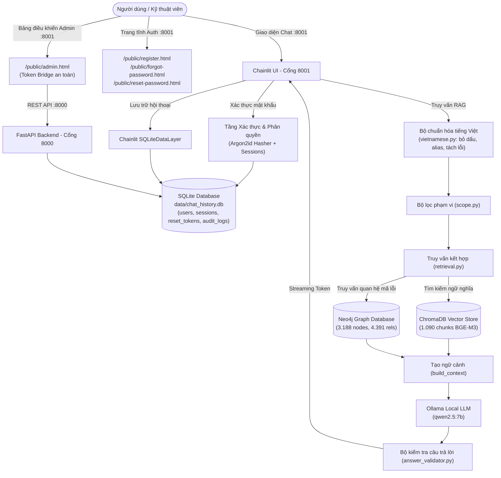

# Trợ lý sự cố điện gia dụng (appliance-troubleshooter-rag)

Hệ thống RAG Chatbot hỗ trợ tra cứu và hướng dẫn chẩn đoán, xử lý sự cố thiết bị điện tử gia dụng (điều hòa, tủ lạnh, máy giặt, máy sấy, lò vi sóng, bếp từ, TV...) cho 3 hãng phổ biến: **Samsung**, **LG** và **Panasonic**.

Ứng dụng kết hợp kỹ thuật **Hybrid RAG** (tìm kiếm ngữ nghĩa Vector qua **ChromaDB** kết hợp truy vấn tri thức đồ thị có cấu trúc qua **Neo4j**), mô hình ngôn ngữ lớn cục bộ (**Local LLM Ollama & Qwen2.5:7B**), giao diện hội thoại **Chainlit** hiện đại, hệ thống xác thực bảo mật **Argon2id**, cơ chế lưu trữ lịch sử trò chuyện bền vững và trang Quản trị viên (Admin Dashboard) chuyên dụng.

---

## Mục lục

1. [Kiến trúc hệ thống](#kiến-trúc-hệ-thống)
2. [Công nghệ sử dụng](#công-nghệ-sử-dụng)
3. [Các tính năng nổi bật](#các-tính-năng-nổi-bật)
4. [Hướng dẫn xem và quản lý dữ liệu lưu trữ (Database Guide)](#hướng-dẫn-xem-và-quản-lý-dữ-liệu-lưu-trữ-database-guide)
   - [Cách 1: Xem nhanh qua Script `scripts/view_data.py`](#cách-1-xem-nhanh-qua-script-scriptsview_datapy)
   - [Cách 2: Xem chi tiết CSDL quan hệ SQLite (`data/chat_history.db`)](#cách-2-xem-chi-tiết-csdl-quan-hệ-sqlite-datachat_historydb)
   - [Cách 3: Xem CSDL vector ChromaDB (`./chroma_data`)](#cách-3-xem-csdl-vector-chromadb-chroma_data)
   - [Cách 4: Xem CSDL đồ thị Neo4j qua Neo4j Browser (`http://localhost:7474`)](#cách-4-xem-csdl-đồ-thị-neo4j-qua-neo4j-browser-httplocalhost7474)
5. [Cài đặt và Khởi động hệ thống](#cài-đặt-và-khởi-động-hệ-thống)
6. [Tài khoản Quản trị viên (Admin)](#tài-khoản-quản-trị-viên-admin)
7. [Kiểm thử tự động (Testing)](#kiểm-thử-tự-động-testing)
8. [Cấu trúc thư mục dự án](#cấu-trúc-thư-mục-dự-án)

---

## Kiến trúc hệ thống

Hệ thống được thiết kế theo mô hình phân tầng rõ ràng, đảm bảo tính giải thích cao (explainability) và dễ trình bày trong các buổi báo cáo/vấn đáp:



---

## Công nghệ sử dụng

| Công nghệ | Vai trò trong hệ thống |
| :--- | :--- |
| **Python 3.12+** | Ngôn ngữ lập trình cốt lõi của toàn bộ ứng dụng. |
| **Chainlit** | Nền tảng giao diện người dùng duy nhất (port 8001), hỗ trợ streaming câu trả lời, prompt starters, chat history sidebar và xác thực người dùng. |
| **FastAPI** | Backend API phục vụ các endpoint RESTful (port 8000), quản lý phiên, xác thực và các API dành cho Quản trị viên (Admin). |
| **SQLite** | Cơ sở dữ liệu quan hệ cục bộ (`data/chat_history.db`) lưu trữ tài khoản, phân quyền, token đặt lại mật khẩu và lịch sử hội thoại bền vững. |
| **Argon2id (`argon2-cffi`)** | Thuật toán mã hóa mật khẩu an toàn theo tiêu chuẩn bảo mật OWASP (m=65536, t=3, p=4), tự động nâng cấp mật khẩu cũ (rehash). |
| **ChromaDB** | Vector Database lưu trữ 1.090 vector nhúng tài liệu kỹ thuật từ dataset thực tế. |
| **BAAI/bge-m3** | Mô hình embedding đa ngôn ngữ hỗ trợ xuất sắc tiếng Việt (chạy qua `sentence-transformers`). |
| **Neo4j** | Graph Database lưu trữ mạng lưới quan hệ có cấu trúc giữa Hãng $\rightarrow$ Thiết bị $\rightarrow$ Sự cố $\rightarrow$ Mã lỗi $\rightarrow$ Giải pháp. |
| **Ollama (Qwen2.5:7B)** | Mô hình ngôn ngữ lớn chạy cục bộ trên máy tính, đảm bảo bảo mật và quyền riêng tư 100%. |
| **uv & pytest** | Công cụ quản lý môi trường ảo siêu tốc và bộ 126+ unit tests bao quát toàn diện. |

---

## Các tính năng nổi bật

### 1. Giao diện người dùng Chainlit & Nhận diện thương hiệu DHV
- Giao diện thân thiện phong cách ChatGPT, hỗ trợ dark/light theme, hiển thị logo DHV và tên hiển thị chính thức: **`Trợ lý sự cố điện gia dụng`**.
- Có các câu hỏi mẫu gợi ý ban đầu (Prompt Starters) giúp người dùng mới dễ dàng bắt đầu.
- Ô nhập liệu (Composer) có placeholder chuẩn tiếng Việt: `"Nhập câu hỏi của bạn..."`.
- **Vô hiệu hóa upload tệp tin**: Toàn bộ icon kẹp ghim, nút upload và thao tác kéo thả tệp tin đều bị chặn hoàn toàn cả ở giao diện lẫn backend để tập trung tra cứu văn bản kỹ thuật.

### 2. Xác thực tài khoản & Khôi phục mật khẩu qua Email (SMTP)
- Hỗ trợ **Đăng ký**, **Đăng nhập** linh hoạt bằng cả `username` hoặc `email`.
- Mật khẩu được mã hóa an toàn bằng **Argon2id**.
- **Quên mật khẩu an toàn qua Email**:
  - Gửi liên kết đặt lại mật khẩu dạng: `http://localhost:8001/public/reset-password.html#token=<token>`.
  - **Bảo mật phân đoạn (#hash)**: Token đặt trong URL fragment để không bao giờ bị lưu vào log máy chủ web hoặc rò rỉ qua header `Referer`.
  - Frontend tự động xóa token khỏi thanh địa chỉ bằng `window.history.replaceState` ngay khi nạp trang.
  - **Bảo vệ mật khẩu cũ**: Khi người dùng yêu cầu reset hoặc gửi token sai/hết hạn, mật khẩu cũ trong CSDL **không bao giờ bị thay đổi hay bị hỏng**.

### 3. Bảng điều khiển Quản trị viên (Dedicated Admin Dashboard)
- **Nút "Quản trị" trên Header**: Nằm ở góc trên bên phải thanh điều hướng Chainlit, **chỉ hiển thị** khi tài khoản có vai trò `role == "admin"`.
- Nhấn nút sẽ kích hoạt cầu nối bảo mật `/admin/bridge-token` và mở trang Quản trị riêng tại `/public/admin.html#token=<token>`.
- Khi gõ lệnh `/admin` trong chat: Chatbot chỉ đưa ra chỉ dẫn ngắn gọn hướng dẫn dùng nút trên Header, không in bảng dữ liệu rườm rà làm rác cuộc trò chuyện.
- **Tính năng quản trị đầy đủ**:
  - Xem thống kê: Tổng số người dùng, số tài khoản hoạt động, số tài khoản bị khóa.
  - Tìm kiếm và phân trang danh sách tài khoản theo username / email.
  - Khóa (Lock) / Mở khóa (Unlock) tài khoản (kèm cơ chế bảo vệ không cho phép khóa Admin cuối cùng).
  - Phân quyền tài khoản (Nâng lên Admin / Hạ xuống User).
  - Kích hoạt gửi email đặt lại mật khẩu cho người dùng.
  - Tra cứu nhật ký kiểm toán quản trị (Admin Audit Logs).
  - Nút **Đăng xuất an toàn**: Thu hồi phiên backend FastAPI, xóa `sessionStorage` và xóa session cookie Chainlit.

### 4. Xử lý tiếng Việt đa biến thể & Hybrid Retrieval
- **Hỗ trợ gõ tiếng Việt tự do**: Có dấu, không dấu, viết hoa, viết thường, hoặc sai lỗi dấu (`dieu hoa pana bao loi f16`, `tu lanh lg khong lanh`).
- **Từ điển Alias thông minh**: Tự động nhận diện `pana` $\rightarrow$ Panasonic, `máy lạnh` $\rightarrow$ điều hòa, `lò vi ba` $\rightarrow$ lò vi sóng, `máy giặt kêu cạch cạch lúc vắt`...
- **Chuẩn hóa khoảng trắng mã lỗi**: Tự động sửa `F 16` $\rightarrow$ `F16`, `U 04` $\rightarrow$ `U04`, `H 97` $\rightarrow$ `H97`.
- **Loại trừ ảo giác (Answer Validator)**: Kiểm chứng câu trả lời của mô hình với tài liệu gốc, không tự bịa mã lỗi hoặc giải pháp sai lệch.

---

## Hướng dẫn xem và quản lý dữ liệu lưu trữ (Database Guide)

Trong dự án có 3 cơ sở dữ liệu với mục đích sử dụng khác nhau. Dưới đây là các cách xem dữ liệu đơn giản nhất phục vụ cho việc kiểm tra và bảo vệ đồ án:

### Cách 1: Xem nhanh qua Script `scripts/view_data.py`

Đây là cách thuận tiện nhất trong buổi vấn đáp để xem toàn bộ dữ liệu chỉ bằng 1 dòng lệnh terminal:

```powershell
uv run python scripts/view_data.py
```

Lệnh này sẽ tự động kiểm tra và in tóm tắt trực quan:
- Danh sách các bảng và số lượng bản ghi trong **SQLite**.
- Danh sách 5 người dùng đăng ký mới nhất (kèm vai trò `admin`/`user`).
- Danh sách 3 cuộc trò chuyện và nội dung câu hỏi - đáp gần nhất.
- Trạng thái kết nối và số lượng vector chunks trong **ChromaDB**.
- Số lượng Nodes và Relationships trong **Neo4j** (nếu server đang bật).

Bạn cũng có thể xem riêng từng cơ sở dữ liệu:
```powershell
uv run python scripts/view_data.py --sqlite    # Xem riêng SQLite
uv run python scripts/view_data.py --chroma    # Xem riêng ChromaDB
uv run python scripts/view_data.py --neo4j     # Xem riêng Neo4j
```

---

### Cách 2: Xem chi tiết CSDL quan hệ SQLite (`data/chat_history.db`)

File database nằm tại đường dẫn: `data/chat_history.db`.

#### Phương pháp 1: Dùng phần mềm giao diện trực quan (Khuyên dùng)
1. Tải và cài đặt phần mềm miễn phí [DB Browser for SQLite](https://sqlitebrowser.org/). Hoặc nếu dùng VS Code / Cursor, bạn có thể cài extension **SQLite Viewer** (của Florian Klampfer).
2. Mở file `data/chat_history.db`.
3. Nhấp vào tab **Browse Data** (Duyệt dữ liệu) để xem nội dung các bảng:
   - `users`: Xem toàn bộ tài khoản, email, mật khẩu đã hash (`password_hash`), vai trò (`role = 'admin'` hoặc `'user'`), trạng thái (`active` hoặc `locked`).
   - `conversations`: Xem danh sách các cuộc trò chuyện đã tạo trên Chainlit kèm tiêu đề.
   - `messages`: Xem toàn bộ các tin nhắn trao đổi giữa người dùng (`role = 'user'`) và trợ lý (`role = 'assistant'`).
   - `sessions`: Danh sách các phiên đăng nhập đang hoạt động.
   - `password_reset_tokens`: Lịch sử các mã token đặt lại mật khẩu đã cấp.
   - `admin_audit_logs`: Nhật ký kiểm toán mọi hành động quản trị (khóa tài khoản, nâng quyền, đổi mật khẩu).

#### Phương pháp 2: Xem nhanh bằng Python CLI
```powershell
# Xem 5 user đầu tiên trong bảng users:
uv run python -c "import sqlite3; c=sqlite3.connect('data/chat_history.db'); [print(r) for r in c.execute('SELECT username, email, role, status FROM users LIMIT 5;').fetchall()]"

# Xem 5 tin nhắn gần nhất:
uv run python -c "import sqlite3; c=sqlite3.connect('data/chat_history.db'); [print(r) for r in c.execute('SELECT role, content FROM messages ORDER BY id DESC LIMIT 5;').fetchall()]"
```

---

### Cách 3: Xem CSDL vector ChromaDB (`./chroma_data`)

ChromaDB lưu trữ vector nhúng của 1.090 tài liệu kỹ thuật trong thư mục `./chroma_data/`.

Dữ liệu vector được lưu dưới dạng file nhị phân của Chroma. Bạn có thể kiểm tra dữ liệu bằng lệnh:

```powershell
uv run python -c "from rag_chatbot.chroma_db import get_chroma_client; col = get_chroma_client().get_collection('electronics_troubleshooting'); print('Tổng số chunks:', col.count()); print('Tài liệu đầu tiên:', col.peek(1))"
```

Kết quả sẽ hiển thị:
- Tên collection: `electronics_troubleshooting`.
- Tổng số chunks: `1090`.
- Metadata đi kèm: `question_id`, `brand`, `device`, `error_code`, `source_url`.
- Nội dung văn bản của document chunk được trích xuất từ dataset Excel.

---

### Cách 4: Xem CSDL đồ thị Neo4j qua Neo4j Browser (`http://localhost:7474`)

Neo4j cung cấp giao diện đồ thị trực quan mạnh mẽ qua trình duyệt web:

1. Khởi động Neo4j Desktop hoặc Neo4j Service trên máy tính của bạn.
2. Mở trình duyệt web truy cập: [http://localhost:7474](http://localhost:7474).
3. Đăng nhập với thông tin cấu hình trong file `.env`:
   - **Connect URL**: `bolt://localhost:7687`
   - **Username**: `neo4j`
   - **Password**: Mật khẩu bạn đã thiết lập (mặc định trong mẫu: `password123`).
4. Gõ các câu lệnh Cypher vào thanh lệnh ở đầu trang và nhấn nút **Run** (Ctrl + Enter):

```cypher
// 1. Xem 25 node và mối quan hệ mẫu bất kỳ trên đồ thị
MATCH (n) RETURN n LIMIT 25;

// 2. Xem toàn bộ các Hãng và Thiết bị mà hệ thống hỗ trợ
MATCH (b:Brand)-[r:HAS_DEVICE]->(d:Device)
RETURN b, r, d;

// 3. Tra cứu trực quan toàn bộ cây quan hệ của mã lỗi 'CF' trên máy điều hòa Samsung (ví dụ Q0358)
MATCH (b:Brand {name: 'Samsung'})-[:HAS_DEVICE]->(d:Device {name: 'Điều hòa'})-[:HAS_ISSUE]->(i:Issue)-[:HAS_ERROR_CODE]->(e:ErrorCode {code: 'CF'})
OPTIONAL MATCH (q:Question)-[:ABOUT]->(i)
OPTIONAL MATCH (q)-[:ANSWERED_BY]->(a:Answer)
RETURN b, d, i, e, q, a;
```

---

## Cài đặt và Khởi động hệ thống

### 1. Chuẩn bị môi trường
- Hệ điều hành: Windows, macOS hoặc Linux.
- Đã cài đặt **Python 3.12+** và công cụ [uv](https://github.com/astral-sh/uv).
- Đã cài đặt và khởi chạy **Neo4j** (port 7687) và **Ollama** (với model `qwen2.5:7b`).

### 2. Cài đặt thư viện dependencies
```powershell
uv sync
```

### 3. Cấu hình file môi trường `.env`
Sao chép từ file mẫu:
```powershell
Copy-Item .env.example .env
```
Mở file `.env` và cập nhật thông tin kết nối Neo4j cùng cấu hình Chainlit:
```ini
APP_NAME=appliance-troubleshooter-rag
APP_ENV=development
DEBUG=True

# Cấu hình Neo4j
NEO4J_URI=bolt://localhost:7687
NEO4J_USER=neo4j
NEO4J_PASSWORD=your_password_here

# Cấu hình ChromaDB
CHROMA_PERSIST_DIRECTORY=./chroma_data
CHROMA_COLLECTION_NAME=electronics_troubleshooting
EMBEDDING_MODEL_NAME=BAAI/bge-m3

# Cấu hình Local LLM (Ollama)
OLLAMA_BASE_URL=http://localhost:11434
LLM_MODEL_NAME=qwen2.5:7b

# Cấu hình CSDL SQLite & URL cổng dịch vụ
SQLITE_DB_PATH=data/chat_history.db
FRONTEND_BASE_URL=http://localhost:8001
CHAINLIT_PORT=8001
API_PORT=8000
CHAINLIT_AUTH_SECRET=dev-chainlit-auth-secret-change-in-production-32chars
```

### 4. Nạp dữ liệu vào cơ sở dữ liệu (chỉ chạy lần đầu)
```powershell
# Nạp dữ liệu vào Neo4j
uv run python -m rag_chatbot.neo4j_db

# Nạp dữ liệu vào ChromaDB
uv run python -m rag_chatbot.ingest
```

### 5. Khởi động toàn bộ hệ thống bằng 1 lệnh duy nhất

Sử dụng launcher PowerShell đã tích hợp sẵn cơ chế kiểm tra cổng mạng, giải phóng cổng xung đột và khởi động đồng thời cả FastAPI và Chainlit:

```powershell
.\scripts\run_dev.ps1
```

Các đường dẫn truy cập sau khi khởi động:
- **Giao diện Chatbot Chainlit**: [http://localhost:8001](http://localhost:8001)
- **Bảng điều khiển Quản trị viên (Admin)**: [http://localhost:8001/public/admin.html](http://localhost:8001/public/admin.html)
- **Trang Đăng ký tài khoản**: [http://localhost:8001/public/register.html](http://localhost:8001/public/register.html)
- **Trang Quên mật khẩu**: [http://localhost:8001/public/forgot-password.html](http://localhost:8001/public/forgot-password.html)
- **Trang Đặt lại mật khẩu**: [http://localhost:8001/public/reset-password.html](http://localhost:8001/public/reset-password.html)
- **FastAPI REST API Docs (Swagger)**: [http://localhost:8000/docs](http://localhost:8000/docs)

---

## Tài khoản Quản trị viên (Admin)

Để tạo tài khoản Quản trị viên có toàn quyền truy cập hệ thống, chạy lệnh tiện ích:

```powershell
uv run python scripts/create_admin.py --username admin --email admin@example.com --password AdminPassword123
```

Sau khi tạo:
1. Đăng nhập vào Chainlit tại [http://localhost:8001](http://localhost:8001) bằng tài khoản vừa tạo.
2. Nút **`🛡️ Quản trị`** sẽ xuất hiện ở góc trên bên phải header của giao diện chat.
3. Nhấn nút để mở Bảng điều khiển quản trị chuyên dụng.

---

## Kiểm thử tự động (Testing)

Dự án có bộ kiểm thử tự động toàn diện được viết bằng `pytest` với hơn 126 test cases:

```powershell
# Chạy toàn bộ kiểm thử
uv run pytest -v

# Chạy riêng kiểm thử luồng Đặt lại mật khẩu & Bảo mật
uv run pytest tests/test_password_reset.py -v

# Chạy riêng kiểm thử Quản trị viên & Phân quyền
uv run pytest tests/test_admin.py -v

# Chạy riêng kiểm thử Giao diện & Chat Composer
uv run pytest tests/test_ui.py -v

# Chạy riêng kiểm thử Xử lý tiếng Việt & Tìm kiếm
uv run pytest tests/test_vietnamese.py tests/test_retrieval_vietnamese.py -v
```

---

## Cấu trúc thư mục dự án

```text
appliance-troubleshooter-rag/
├── .chainlit/
│   ├── config.toml                      # Cấu hình Chainlit (theme, tắt upload file)
│   └── translations/
│       └── en-US.json                   # Chuỗi dịch ngôn ngữ (placeholder tiếng Việt)
├── chroma_data/                         # Thư mục lưu trữ cơ sở dữ liệu vector ChromaDB
├── data/
│   ├── chat_history.db                  # CSDL SQLite lưu users, sessions, chat history, audit logs
│   ├── evaluation/                      # Tập dữ liệu kiểm thử và kết quả đo lường
│   └── raw/
│       └── dataset.xlsx                 # Dataset gốc gồm 1.090 bản ghi sự cố kỹ thuật
├── docs/                                # Báo cáo kiến trúc và tài liệu di trú Chainlit
├── public/                              # Tài nguyên tĩnh phục vụ giao diện
│   ├── admin.html                       # Giao diện Bảng điều khiển Quản trị viên chuyên biệt
│   ├── branding/
│   │   └── dhv-logo.png                 # Logo thương hiệu DHV
│   ├── custom.css                       # CSS tùy biến giao diện đăng nhập, header button, composer
│   ├── custom.js                        # JS tiêm nút Admin header, việt hóa, chặn drag-drop file
│   ├── forgot-password.html             # Giao diện yêu cầu quên mật khẩu
│   ├── register.html                    # Giao diện đăng ký tài khoản mới
│   └── reset-password.html              # Giao diện đặt lại mật khẩu với token hash
├── scripts/
│   ├── create_admin.py                  # Script CLI tạo tài khoản Quản trị viên
│   ├── run_dev.ps1                      # Script PowerShell khởi động hệ thống 1 chạm
│   └── view_data.py                     # Script xem nhanh dữ liệu các CSDL (SQLite, Chroma, Neo4j)
├── src/
│   └── rag_chatbot/
│       ├── auth.py                      # Xác thực, băm Argon2id, quản lý phiên và token reset
│       ├── chainlit_app.py              # Ứng dụng giao diện Chainlit chính & token bridge
│       ├── chainlit_data_layer.py       # SQLiteDataLayer lưu lịch sử chat Chainlit vào SQLite
│       ├── chat_service.py              # Dịch vụ điều phối câu hỏi - đáp RAG
│       ├── chroma_db.py                 # Kết nối và cấu hình ChromaDB Vector Store
│       ├── config.py                    # Quản lý cấu hình tập trung qua Pydantic Settings
│       ├── database.py                  # Thao tác CSDL SQLite (bảng users, chat, audit logs)
│       ├── email_service.py             # Dịch vụ gửi email khôi phục mật khẩu qua SMTP / Dev Mock
│       ├── main.py                      # Ứng dụng FastAPI REST API & Admin API endpoints
│       ├── neo4j_db.py                  # Kết nối và nạp dữ liệu đồ thị Neo4j
│       ├── rag.py                       # Luồng tổng hợp prompt, context và gọi Ollama LLM
│       ├── retrieval.py                 # Truy vấn kết hợp Hybrid Retrieval (ChromaDB + Neo4j)
│       ├── scope.py                     # Bộ lọc phát hiện và chặn câu hỏi ngoài phạm vi
│       └── vietnamese.py                # Xử lý tiếng Việt (bỏ dấu, alias, tách khoảng trắng mã lỗi)
├── tests/                               # Thư mục chứa toàn bộ unit tests và regression tests
├── .env.example                         # File mẫu cấu hình biến môi trường
├── pyproject.toml                       # Khai báo cấu hình dự án, gói và dependencies uv
└── README.md                            # Tài liệu hướng dẫn sử dụng chính thức
```

---

## Tuyên bố học thuật

Dự án được xây dựng với mục tiêu phục vụ học tập, nghiên cứu và bảo vệ đồ án/khóa luận.
