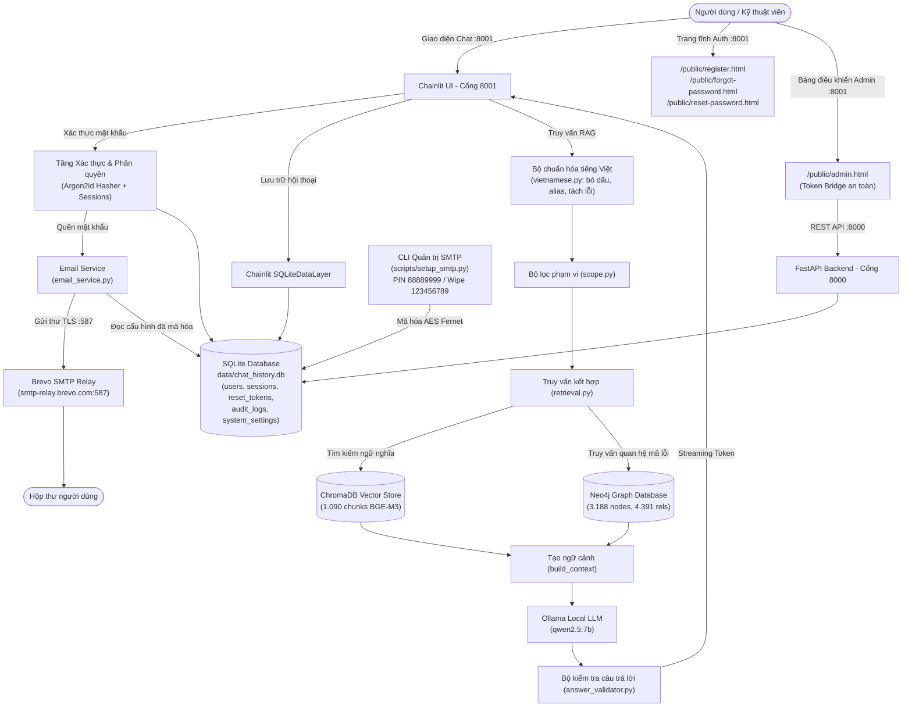

# Trợ Lý Sự Cố Thiết Bị Điện Gia Dụng (appliance-troubleshooter-rag)

Hệ thống RAG Chatbot hỗ trợ tra cứu và hướng dẫn chẩn đoán, xử lý sự cố thiết bị điện tử gia dụng (điều hòa, tủ lạnh, máy giặt, máy sấy, lò vi sóng, bếp từ, TV...) cho 3 hãng phổ biến: **Samsung**, **LG** và **Panasonic**.

Ứng dụng kết hợp kỹ thuật **Hybrid RAG** (tìm kiếm ngữ nghĩa Vector qua **ChromaDB** kết hợp truy vấn tri thức đồ thị có cấu trúc qua **Neo4j**), mô hình ngôn ngữ lớn cục bộ (**Local LLM Ollama & Qwen2.5:7B**), giao diện hội thoại **Chainlit** hiện đại, hệ thống xác thực bảo mật **Argon2id**, dịch vụ gửi email khôi phục mật khẩu tin cậy qua **Brevo SMTP**, cơ chế mã hóa dữ liệu tại chỗ (**Encryption at Rest với AES Fernet**) trong SQLite và trang Quản trị viên (Admin Dashboard) chuyên dụng.

---

## Mục lục

1. [Kiến trúc hệ thống](#kiến-trúc-hệ-thống)
2. [Công nghệ sử dụng](#công-nghệ-sử-dụng)
3. [Các tính năng nổi bật](#các-tính-năng-nổi-bật)
4. [Hướng dẫn quản lý và kiểm tra dữ liệu lưu trữ (Database Guide)](#hướng-dẫn-quản-lý-và-kiểm-tra-dữ-liệu-lưu-trữ-database-guide)
   - [1. Kiểm tra tổng quan hệ thống qua CLI Tool (`scripts/view_data.py`)](#1-kiểm-tra-tổng-quan-hệ-thống-qua-cli-tool-scriptsview_datapy)
   - [2. Quản lý cấu hình SMTP mã hóa & Mã số xóa khẩn cấp (`scripts/setup_smtp.py`)](#2-quản-lý-cấu-hình-smtp-mã-hóa--mã-số-xóa-khẩn-cấp-scriptssetup_smtppy)
   - [3. Quản lý CSDL quan hệ SQLite (`data/chat_history.db`)](#3-quản-lý-csdl-quan-hệ-sqlite-datachat_historydb)
   - [4. Kiểm tra CSDL vector ChromaDB (`./chroma_data`)](#4-kiểm-tra-csdl-vector-chromadb-chroma_data)
   - [5. Truy vấn CSDL đồ thị Neo4j qua Neo4j Browser (`http://localhost:7474`)](#5-truy-vấn-csdl-đồ-thị-neo4j-qua-neo4j-browser-httplocalhost7474)
5. [Cài đặt và Khởi động hệ thống](#cài-đặt-và-khởi-động-hệ-thống)
6. [Tài khoản Quản trị viên (Admin)](#tài-khoản-quản-trị-viên-admin)
7. [Kiểm thử tự động (Testing)](#kiểm-thử-tự-động-testing)
8. [Cấu trúc thư mục dự án](#cấu-trúc-thư-mục-dự-án)
9. [Mục tiêu dự án](#mục-tiêu-dự-án)

---

## Kiến trúc hệ thống

Hệ thống được thiết kế theo mô hình phân tầng rõ ràng, đảm bảo tính giải thích cao (explainability), tính module hóa và dễ dàng bảo trì:



---

## Công nghệ sử dụng

| Công nghệ | Vai trò trong hệ thống |
| :--- | :--- |
| **Python 3.12** | Ngôn ngữ lập trình cốt lõi của toàn bộ ứng dụng (yêu cầu `>=3.12,<3.13` theo `pyproject.toml`). |
| **Chainlit** | Nền tảng giao diện người dùng duy nhất (port 8001), hỗ trợ streaming câu trả lời, prompt starters, chat history sidebar và xác thực người dùng. |
| **FastAPI** | Backend API phục vụ các endpoint RESTful (port 8000), quản lý phiên, xác thực và các API dành cho Quản trị viên (Admin). |
| **SQLite** | Cơ sở dữ liệu quan hệ cục bộ (`data/chat_history.db`) lưu trữ tài khoản, phân quyền, token đặt lại mật khẩu, cấu hình hệ thống mã hóa và lịch sử hội thoại bền vững. |
| **Argon2id (`argon2-cffi`)** | Thuật toán băm mật khẩu an toàn theo tiêu chuẩn OWASP (m=65536, t=3, p=4), tự động nâng cấp mật khẩu cũ (rehash). |
| **Brevo SMTP Relay** | Máy chủ chuyển tiếp thư điện tử tin cậy (TLS port 587) gửi email đặt lại mật khẩu an toàn, ổn định vào Hộp thư đến (Inbox). |
| **AES Fernet (`cryptography`)** | Thuật toán mã hóa đối xứng AES-128-CBC kết hợp HMAC-SHA256, bảo mật cấu hình nhạy cảm (SMTP Key, tài khoản email) trong CSDL SQLite. |
| **ChromaDB** | Vector Database lưu trữ 1.090 vector nhúng tài liệu kỹ thuật từ dataset thực tế. |
| **BAAI/bge-m3** | Mô hình embedding đa ngôn ngữ hỗ trợ xuất sắc tiếng Việt (chạy qua `sentence-transformers`). |
| **Neo4j** | Graph Database lưu trữ mạng lưới quan hệ có cấu trúc giữa Hãng $\rightarrow$ Thiết bị $\rightarrow$ Sự cố $\rightarrow$ Mã lỗi $\rightarrow$ Giải pháp. |
| **Ollama (Qwen2.5:7B)** | Mô hình ngôn ngữ lớn chạy cục bộ trên máy tính, đảm bảo bảo mật và quyền riêng tư 100%. |
| **uv & pytest** | Công cụ quản lý môi trường ảo siêu tốc và bộ 135 unit tests bao quát toàn diện các tầng hệ thống. |

---

## Các tính năng nổi bật

### 1. Giao diện người dùng Chainlit & Nhận diện thương hiệu DHV
- Giao diện trực quan, hiện đại, hỗ trợ chuyển đổi linh hoạt chế độ Sáng/Tối (Light/Dark theme).
- Nhận diện thương hiệu chính thức với logo DHV và tên hệ thống: **`Trợ Lý Sự Cố Thiết Bị Điện Gia Dụng`**.
- Tích hợp các câu hỏi mẫu gợi ý ban đầu (Prompt Starters) giúp người dùng nhanh chóng làm quen và tra cứu sự cố thường gặp.
- Hộp thoại nhập liệu (Composer) hỗ trợ tiếng Việt tự nhiên và tối ưu trải nghiệm tương tác với hệ thống.

### 2. Xác thực tài khoản, Bảo mật CSDL & Khôi phục mật khẩu qua Email (Brevo SMTP)
- Hỗ trợ **Đăng ký**, **Đăng nhập** linh hoạt bằng cả `username` hoặc `email`.
- Mật khẩu được băm bảo mật bằng thuật toán hiện đại **Argon2id**.
- **Tích hợp Brevo SMTP gửi email thực tế**:
  - Tự động gửi email thông báo đặt lại mật khẩu với giao diện HTML thương hiệu chuyên nghiệp.
  - Hỗ trợ kết nối chuẩn TLS qua cổng 587 của Brevo Relay, giúp email không bị chặn hoặc đưa vào thư mục rác (Spam).
- **Mã hóa dữ liệu tại chỗ (Encryption at Rest với AES Fernet)**:
  - Cấu hình SMTP (bao gồm API Key và tài khoản) được mã hóa đối xứng an toàn trước khi lưu vào bảng `system_settings` trong SQLite.
  - Ngay cả khi file CSDL `data/chat_history.db` bị trích xuất hoặc mở bằng công cụ xem SQLite thông thường, khóa SMTP vẫn hoàn toàn vô hại ở dạng chuỗi ciphertext ngẫu nhiên.
- **Bảo vệ bằng mã PIN & Cơ chế Mã số xóa khẩn cấp (Master Wipe Code)**:
  - **Mã PIN quản trị** (mặc định: **`88889999`**): Bắt buộc nhập đúng mã PIN để truy cập menu điều chỉnh hoặc xem cấu hình SMTP (khóa bí mật luôn được ẩn `••••••••`).
  - **Mã số xóa khẩn cấp (Wipe Code)** (mặc định: **`123456789`**): Khi người dùng hoặc quản trị viên nhập mã này, toàn bộ tài khoản SMTP cũ và mã PIN trong CSDL sẽ được **tự động xóa sạch hoàn toàn**. Hệ thống ngay lập tức mở khóa cho phép thiết lập cấu hình mới mà **không đòi hỏi mật khẩu cũ**, sau đó yêu cầu thiết lập mã PIN mới cho các lần chỉnh sửa tiếp theo.
- **Quy trình đặt lại mật khẩu an toàn**:
  - Gửi liên kết dạng: `http://localhost:8001/public/reset-password.html#token=<token>`.
  - **Bảo mật phân đoạn (#hash)**: Token đặt trong URL fragment để không bao giờ bị ghi vào log máy chủ web hoặc rò rỉ qua header `Referer`.
  - Frontend tự động xóa token khỏi thanh địa chỉ bằng `window.history.replaceState` ngay khi nạp trang.
  - **Bảo vệ chống spam**: Giới hạn khoảng cách tối thiểu 15 giây (Cooldown) và tối đa 3 yêu cầu/15 phút cho mỗi địa chỉ email.
  - **Bảo vệ mật khẩu cũ**: Khi người dùng yêu cầu reset hoặc gửi token sai/hết hạn, mật khẩu cũ trong CSDL **không bao giờ bị thay đổi hay bị hỏng**.

### 3. Bảng điều khiển Quản trị viên (Dedicated Admin Dashboard)
- **Nút "Quản trị" trên Header**: Nằm ở góc trên bên phải thanh điều hướng Chainlit, **chỉ hiển thị** khi tài khoản có vai trò `role == "admin"`.
- Nhấn nút sẽ kích hoạt cầu nối bảo mật `/admin/bridge-token` và mở trang Quản trị riêng tại `/public/admin.html#token=<token>`.
- Khi gõ lệnh `/admin` trong chat: Chatbot chỉ đưa ra chỉ dẫn ngắn gọn hướng dẫn dùng nút trên Header, không in bảng dữ liệu rườm rà làm rác cuộc trò chuyện.
- **Tính năng quản trị đầy đủ**:
  - Xem thống kê: Tổng số người dùng, số tài khoản hoạt động, số tài khoản bị khóa.
  - Tìm kiếm và phân trang danh sách tài khoản theo username / email.
  - Khóa (Lock) / Mở khóa (Unlock) tài khoản (kèm cơ chế bảo vệ không cho phép khóa Admin cuối cùng).
  - Phân quyền tài khoản (Nâng lên Admin / Hạ xuống User).
  - Kích hoạt gửi email đặt lại mật khẩu cho người dùng.
  - Tra cứu nhật ký kiểm toán quản trị (Admin Audit Logs).
  - Nút **Đăng xuất an toàn**: Thu hồi phiên backend FastAPI, xóa `sessionStorage` và xóa session cookie Chainlit.

### 4. Xử lý tiếng Việt đa biến thể & Hybrid Retrieval
- **Hỗ trợ gõ tiếng Việt tự do**: Có dấu, không dấu, viết hoa, viết thường, hoặc sai lỗi dấu (`dieu hoa pana bao loi f16`, `tu lanh lg khong lanh`).
- **Từ điển Alias thông minh**: Tự động nhận diện `pana` $\rightarrow$ Panasonic, `máy lạnh` $\rightarrow$ điều hòa, `lò vi ba` $\rightarrow$ lò vi sóng, `máy giặt kêu cạch cạch lúc vắt`...
- **Chuẩn hóa khoảng trắng mã lỗi**: Tự động sửa `F 16` $\rightarrow$ `F16`, `U 04` $\rightarrow$ `U04`, `H 97` $\rightarrow$ `H97`.
- **Loại trừ ảo giác (Answer Validator)**: Kiểm chứng câu trả lời của mô hình với tài liệu gốc, không tự bịa mã lỗi hoặc giải pháp sai lệch.

---

## Hướng dẫn quản lý và kiểm tra dữ liệu lưu trữ (Database Guide)

Hệ thống tích hợp 3 cơ sở dữ liệu chuyên biệt phục vụ các mục tiêu khác nhau (Quan hệ, Vector và Đồ thị tri thức). Dưới đây là các phương pháp kiểm tra và truy xuất dữ liệu của từng thành phần:

### 1. Kiểm tra tổng quan hệ thống qua CLI Tool (`scripts/view_data.py`)

Hệ thống cung cấp script công cụ tổng hợp giúp kiểm tra nhanh trạng thái kết nối và số liệu thống kê của cả 3 cơ sở dữ liệu:

```powershell
uv run python scripts/view_data.py
```

Lệnh này sẽ tự động kiểm tra và in tóm tắt trực quan:
- Danh sách các bảng và số lượng bản ghi trong **SQLite**.
- Danh sách 5 người dùng đăng ký mới nhất (kèm vai trò `admin`/`user`).
- Danh sách 3 cuộc trò chuyện và nội dung câu hỏi - đáp gần nhất.
- Trạng thái kết nối và số lượng vector chunks trong **ChromaDB**.
- Số lượng Nodes và Relationships trong **Neo4j** (nếu server đang bật).

Bạn cũng có thể xem riêng từng cơ sở dữ liệu:
```powershell
uv run python scripts/view_data.py --sqlite    # Xem riêng SQLite
uv run python scripts/view_data.py --chroma    # Xem riêng ChromaDB
uv run python scripts/view_data.py --neo4j     # Xem riêng Neo4j
```

---

### 2. Quản lý cấu hình SMTP mã hóa & Mã số xóa khẩn cấp (`scripts/setup_smtp.py`)

Công cụ CLI tương tác chuyên dụng giúp quản trị viên cấu hình Brevo SMTP an toàn:

#### a. Khởi chạy ở chế độ tương tác:
```powershell
uv run python scripts/setup_smtp.py
```
- **Nếu CSDL chưa có cấu hình (hoặc vừa bị xóa sạch)**: Hệ thống tự động vào chế độ thiết lập mới, cho phép nhập Host, Port, Username, SMTP Key mà **không yêu cầu mật khẩu cũ**. Cuối cùng, hệ thống yêu cầu thiết lập mã PIN bảo vệ mới.
- **Nếu CSDL đã có cấu hình**: Hệ thống yêu cầu nhập mã PIN bảo vệ (mặc định: `88889999`) hoặc Mã số xóa khẩn cấp (mặc định: `123456789`).

#### b. Các lệnh tiện ích dòng lệnh (CLI flags):
```powershell
# 1. Xem trạng thái cấu hình hiện tại (ẩn ký tự nhạy cảm)
uv run python scripts/setup_smtp.py --pin 88889999

# 2. Kiểm tra bắt tay xác thực với máy chủ Brevo
uv run python scripts/setup_smtp.py --pin 88889999 --test

# 3. Đổi mã PIN bảo vệ mới
uv run python scripts/setup_smtp.py --pin 88889999 --set-pin 99998888

# 4. Tự động xóa sạch cấu hình SMTP bằng Mã số xóa khẩn cấp (Wipe Code)
uv run python scripts/setup_smtp.py --wipe-code 123456789 --purge
```

---

### 3. Quản lý CSDL quan hệ SQLite (`data/chat_history.db`)

File database nằm tại đường dẫn: `data/chat_history.db`.

#### Phương pháp 1: Dùng phần mềm giao diện trực quan (Khuyên dùng)
1. Tải và cài đặt phần mềm miễn phí [DB Browser for SQLite](https://sqlitebrowser.org/) (hoặc extension **SQLite Viewer** trên VS Code).
2. Mở file `data/chat_history.db`.
3. Nhấp vào tab **Browse Data** (Duyệt dữ liệu) để xem nội dung các bảng:
   - `users`: Toàn bộ tài khoản, email, mật khẩu đã băm (`password_hash`), vai trò (`role = 'admin'` hoặc `'user'`), trạng thái (`active` hoặc `locked`).
   - `conversations`: Danh sách các cuộc trò chuyện đã tạo trên Chainlit kèm tiêu đề.
   - `messages`: Toàn bộ các tin nhắn trao đổi giữa người dùng (`role = 'user'`) và trợ lý (`role = 'assistant'`).
   - `sessions`: Danh sách các phiên đăng nhập đang hoạt động.
   - `password_reset_tokens`: Lịch sử các mã token đặt lại mật khẩu đã cấp.
   - `password_reset_rate_limits`: Lịch sử thời gian gửi yêu cầu để kiểm soát giới hạn tần suất gửi email.
   - `admin_audit_logs`: Nhật ký kiểm toán mọi hành động quản trị (khóa tài khoản, nâng quyền, đổi mật khẩu).
   - `system_settings`: Cấu hình hệ thống được mã hóa. Cột `value` của khóa `smtp_config` chứa ciphertext đã mã hóa bằng AES Fernet, đảm bảo an toàn tuyệt đối ngay cả khi mở trực tiếp file SQLite.

#### Phương pháp 2: Xem nhanh bằng Python CLI
```powershell
# Xem 5 user đầu tiên trong bảng users:
uv run python -c "import sqlite3; c=sqlite3.connect('data/chat_history.db'); [print(r) for r in c.execute('SELECT username, email, role, status FROM users LIMIT 5;').fetchall()]"

# Xem 5 tin nhắn gần nhất:
uv run python -c "import sqlite3; c=sqlite3.connect('data/chat_history.db'); [print(r) for r in c.execute('SELECT role, content FROM messages ORDER BY id DESC LIMIT 5;').fetchall()]"

# Xem dữ liệu cấu hình đã mã hóa trong bảng system_settings:
uv run python -c "import sqlite3; c=sqlite3.connect('data/chat_history.db'); [print(r) for r in c.execute('SELECT key, value, updated_at FROM system_settings;').fetchall()]"
```

---

### 4. Kiểm tra CSDL vector ChromaDB (`./chroma_data`)

ChromaDB lưu trữ vector nhúng của 1.090 tài liệu kỹ thuật trong thư mục `./chroma_data/`.

Dữ liệu vector được lưu dưới dạng file nhị phân của Chroma. Bạn có thể kiểm tra dữ liệu bằng lệnh:

```powershell
uv run python -c "from rag_chatbot.chroma_db import get_chroma_client; col = get_chroma_client().get_collection('electronics_troubleshooting'); print('Tổng số chunks:', col.count()); print('Tài liệu đầu tiên:', col.peek(1))"
```

Kết quả sẽ hiển thị:
- Tên collection: `electronics_troubleshooting`.
- Tổng số chunks: `1090`.
- Metadata đi kèm: `question_id`, `brand`, `device`, `error_code`, `source_url`.
- Nội dung văn bản của document chunk được trích xuất từ dataset Excel.

---

### 5. Truy vấn CSDL đồ thị Neo4j qua Neo4j Browser (`http://localhost:7474`)

Neo4j cung cấp giao diện đồ thị trực quan mạnh mẽ qua trình duyệt web:

1. Khởi động Neo4j Desktop hoặc Neo4j Service trên máy tính của bạn.
2. Mở trình duyệt web truy cập: [http://localhost:7474](http://localhost:7474).
3. Đăng nhập với thông tin cấu hình trong file `.env`:
   - **Connect URL**: `bolt://localhost:7687`
   - **Username**: `neo4j`
   - **Password**: Mật khẩu bạn đã thiết lập (mặc định trong mẫu: `password123`).
4. Gõ các câu lệnh Cypher vào thanh lệnh ở đầu trang và nhấn nút **Run** (Ctrl + Enter):

```cypher
// 1. Xem 25 node và mối quan hệ mẫu bất kỳ trên đồ thị
MATCH (n) RETURN n LIMIT 25;

// 2. Xem toàn bộ các Hãng và Thiết bị mà hệ thống hỗ trợ
MATCH (b:Brand)-[r:HAS_DEVICE]->(d:Device)
RETURN b, r, d;

// 3. Tra cứu trực quan toàn bộ cây quan hệ của mã lỗi 'CF' trên máy điều hòa Samsung (ví dụ Q0358)
MATCH (b:Brand {name: 'Samsung'})-[:HAS_DEVICE]->(d:Device {name: 'Điều hòa'})-[:HAS_ISSUE]->(i:Issue)-[:HAS_ERROR_CODE]->(e:ErrorCode {code: 'CF'})
OPTIONAL MATCH (q:Question)-[:ABOUT]->(i)
OPTIONAL MATCH (q)-[:ANSWERED_BY]->(a:Answer)
RETURN b, d, i, e, q, a;
```

---

## Cài đặt và Khởi động hệ thống

### 1. Chuẩn bị môi trường
- Hệ điều hành: Windows, macOS hoặc Linux.
- Đã cài đặt **Python 3.12** (khai báo hỗ trợ `>=3.12,<3.13` theo `pyproject.toml`) và công cụ [uv](https://github.com/astral-sh/uv).
- Đã cài đặt và khởi chạy **Neo4j** (port 7687) và **Ollama** (với model `qwen2.5:7b`).

### 2. Cài đặt thư viện dependencies
```powershell
uv sync
```

### 3. Cấu hình file môi trường `.env`
Sao chép từ file mẫu:
```powershell
Copy-Item .env.example .env
```
Mở file `.env` và cập nhật thông tin kết nối Neo4j cùng cấu hình Chainlit:
```ini
APP_NAME=appliance-troubleshooter-rag
APP_ENV=development
DEBUG=True

# Cấu hình Neo4j
NEO4J_URI=bolt://localhost:7687
NEO4J_USER=neo4j
NEO4J_PASSWORD=your_password_here

# Cấu hình ChromaDB
CHROMA_PERSIST_DIRECTORY=./chroma_data
CHROMA_COLLECTION_NAME=electronics_troubleshooting
EMBEDDING_MODEL_NAME=BAAI/bge-m3

# Cấu hình Local LLM (Ollama)
OLLAMA_BASE_URL=http://localhost:11434
LLM_MODEL_NAME=qwen2.5:7b

# Cấu hình CSDL SQLite & URL cổng dịch vụ
SQLITE_DB_PATH=data/chat_history.db
# URL giao diện người dùng Chainlit (bắt buộc đặt http://localhost:8001 để liên kết đặt lại mật khẩu trong email trỏ chính xác về cổng giao diện 8001)
FRONTEND_BASE_URL=http://localhost:8001
CHAINLIT_PORT=8001
API_PORT=8000
CHAINLIT_AUTH_SECRET=dev-chainlit-auth-secret-change-in-production-32chars
```

### 4. Cấu hình Brevo SMTP gửi email (Tùy chọn nhưng khuyên dùng)
Để kích hoạt tính năng gửi email đặt lại mật khẩu thực tế:
```powershell
uv run python scripts/setup_smtp.py
```
Nhập thông tin Brevo SMTP (Host: `smtp-relay.brevo.com`, Port: `587`, Username và SMTP Key). Nếu chưa cấu hình, hệ thống sẽ tự động sử dụng chế độ Dev Mock (in liên kết đặt lại mật khẩu ra màn hình console để kiểm thử tiện lợi).

### 5. Nạp dữ liệu vào cơ sở dữ liệu (chỉ chạy lần đầu)
```powershell
# Nạp dữ liệu vào Neo4j
uv run python -m rag_chatbot.neo4j_db

# Nạp dữ liệu vào ChromaDB
uv run python -m rag_chatbot.ingest
```

### 6. Khởi động toàn bộ hệ thống bằng 1 lệnh duy nhất

Sử dụng launcher PowerShell đã tích hợp sẵn cơ chế kiểm tra cổng mạng, giải phóng cổng xung đột và khởi động đồng thời cả FastAPI và Chainlit:

```powershell
.\scripts\run_dev.ps1
```

Các đường dẫn truy cập sau khi khởi động:
- **Giao diện Chatbot Chainlit**: [http://localhost:8001](http://localhost:8001)
- **Bảng điều khiển Quản trị viên (Admin)**: [http://localhost:8001/public/admin.html](http://localhost:8001/public/admin.html)
- **Trang Đăng ký tài khoản**: [http://localhost:8001/public/register.html](http://localhost:8001/public/register.html)
- **Trang Quên mật khẩu**: [http://localhost:8001/public/forgot-password.html](http://localhost:8001/public/forgot-password.html)
- **Trang Đặt lại mật khẩu**: [http://localhost:8001/public/reset-password.html](http://localhost:8001/public/reset-password.html)
- **FastAPI REST API Docs (Swagger)**: [http://localhost:8000/docs](http://localhost:8000/docs)

---

## Tài khoản Quản trị viên (Admin)

Để tạo tài khoản Quản trị viên có toàn quyền truy cập hệ thống, chạy lệnh tiện ích:

```powershell
uv run python scripts/create_admin.py --username admin --email admin@example.com --password AdminPassword123
```

Sau khi tạo:
1. Đăng nhập vào Chainlit tại [http://localhost:8001](http://localhost:8001) bằng tài khoản vừa tạo.
2. Nút **`🛡️ Quản trị`** sẽ xuất hiện ở góc trên bên phải header của giao diện chat.
3. Nhấn nút để mở Bảng điều khiển quản trị chuyên dụng.

---

## Kiểm thử tự động (Testing)

Dự án có bộ kiểm thử tự động toàn diện được viết bằng `pytest` với **135 test cases** (phân bổ tương ứng 1:1 theo 14 module chức năng cốt lõi của hệ thống):

```powershell
# Chạy toàn bộ kiểm thử
uv run pytest -v

# Chạy riêng kiểm thử Mã hóa CSDL & Bảo mật cấu hình SMTP
uv run pytest tests/test_smtp_db.py -v

# Chạy riêng kiểm thử luồng Đặt lại mật khẩu & Bảo mật
uv run pytest tests/test_password_reset.py -v

# Chạy riêng kiểm thử Quản trị viên & Phân quyền
uv run pytest tests/test_admin.py -v

# Chạy riêng kiểm thử Giao diện & Chat Composer
uv run pytest tests/test_ui.py -v

# Chạy riêng kiểm thử Xử lý tiếng Việt (dấu, alias, mã lỗi)
uv run pytest tests/test_vietnamese.py -v
```

---

## Cấu trúc thư mục dự án

```text
appliance-troubleshooter-rag/
├── .chainlit/
│   ├── config.toml                      # Cấu hình giao diện và hệ thống Chainlit (cache-busting v=3)
│   └── translations/
│       └── en-US.json                   # Chuỗi dịch ngôn ngữ (placeholder tiếng Việt)
├── chroma_data/                         # Thư mục lưu trữ cơ sở dữ liệu vector ChromaDB
├── data/
│   ├── chat_history.db                  # CSDL SQLite lưu users, sessions, chat history, audit logs, system_settings
│   ├── evaluation/                      # Tập dữ liệu kiểm thử và kết quả đo lường
│   └── raw/
│       └── dataset.xlsx                 # Dataset gốc gồm 1.090 bản ghi sự cố kỹ thuật
├── public/                              # Tài nguyên tĩnh phục vụ giao diện
│   ├── admin.html                       # Giao diện Bảng điều khiển Quản trị viên chuyên biệt
│   ├── branding/
│   │   └── dhv-logo.png                 # Logo thương hiệu DHV
│   ├── custom.css                       # CSS tùy biến giao diện đăng nhập, header button, composer
│   ├── custom.js                        # JS tùy biến giao diện, nút Quản trị và thương hiệu hệ thống
│   ├── forgot-password.html             # Giao diện yêu cầu quên mật khẩu
│   ├── register.html                    # Giao diện đăng ký tài khoản mới
│   └── reset-password.html              # Giao diện đặt lại mật khẩu với token hash
├── scripts/
│   ├── cleanup_test_accounts.py         # Script dọn dẹp các tài khoản kiểm thử
│   ├── create_admin.py                  # Script CLI tạo tài khoản Quản trị viên
│   ├── run_dev.ps1                      # Script PowerShell khởi động hệ thống 1 chạm
│   ├── setup_smtp.py                    # Script CLI quản lý và mã hóa cấu hình Brevo SMTP an toàn
│   └── view_data.py                     # Script xem nhanh dữ liệu các CSDL (SQLite, Chroma, Neo4j)
├── src/
│   └── rag_chatbot/
│       ├── answer_validator.py          # Bộ kiểm tra tính chính xác và an toàn câu trả lời LLM
│       ├── auth.py                      # Xác thực, băm Argon2id, quản lý phiên và token reset
│       ├── chainlit_app.py              # Ứng dụng giao diện Chainlit chính & token bridge
│       ├── chainlit_data_layer.py       # SQLiteDataLayer lưu lịch sử chat Chainlit vào SQLite
│       ├── chat_service.py              # Dịch vụ điều phối câu hỏi - đáp RAG
│       ├── chroma_db.py                 # Kết nối và cấu hình ChromaDB Vector Store
│       ├── config.py                    # Quản lý cấu hình tập trung qua Pydantic Settings
│       ├── database.py                  # Thao tác CSDL SQLite (bảng users, chat, audit logs, system_settings)
│       ├── email_service.py             # Dịch vụ gửi email khôi phục mật khẩu qua Brevo SMTP / Dev Mock
│       ├── evaluation.py                # Đo lường và đánh giá chất lượng hệ thống RAG (Hit Rate, MRR)
│       ├── ingest.py                    # Nạp dữ liệu sự cố từ dataset.xlsx vào ChromaDB & Neo4j
│       ├── knowledge_eval.py            # Đánh giá độ phủ tri thức thiết bị, mã lỗi và giải pháp
│       ├── main.py                      # Ứng dụng FastAPI REST API & Admin API endpoints
│       ├── neo4j_db.py                  # Kết nối và nạp dữ liệu đồ thị Neo4j
│       ├── rag.py                       # Luồng tổng hợp prompt, context và gọi Ollama LLM
│       ├── reranker.py                  # Module xếp hạng lại kết quả truy vấn (Neural/Cross-encoder)
│       ├── retrieval.py                 # Truy vấn kết hợp Hybrid Retrieval (ChromaDB + Neo4j)
│       ├── scope.py                     # Bộ lọc phát hiện và chặn câu hỏi ngoài phạm vi
│       └── vietnamese.py                # Xử lý tiếng Việt (bỏ dấu, alias, tách khoảng trắng mã lỗi)
├── tests/                               # Thư mục kiểm thử tự động (14 module cốt lõi, 135 test cases)
│   ├── conftest.py                      # Cấu hình fixtures và CSDL test cô lập
│   ├── test_admin.py                    # Kiểm thử quyền Quản trị viên và bảng điều khiển
│   ├── test_answer_validator.py         # Kiểm thử chống ảo giác câu trả lời (Answer Validator)
│   ├── test_api.py                      # Kiểm thử các endpoint FastAPI backend
│   ├── test_auth_and_history.py         # Kiểm thử xác thực và lưu trữ lịch sử hội thoại SQLite
│   ├── test_chroma.py                   # Kiểm thử tìm kiếm ngữ nghĩa trên ChromaDB
│   ├── test_config.py                   # Kiểm thử nạp và quản lý cấu hình hệ thống
│   ├── test_hybrid.py                   # Kiểm thử kết hợp tìm kiếm ChromaDB và Neo4j
│   ├── test_neo4j.py                    # Kiểm thử kết nối và quan hệ đồ thị Neo4j
│   ├── test_password_reset.py           # Kiểm thử luồng gửi email và đổi mật khẩu an toàn
│   ├── test_rag.py                      # Kiểm thử pipeline RAG và tích hợp mô hình LLM
│   ├── test_scope.py                    # Kiểm thử bộ lọc câu hỏi ngoài phạm vi (Scope Guard)
│   ├── test_smtp_db.py                  # Kiểm thử mã hóa AES Fernet SMTP, PIN và Wipe Code
│   ├── test_ui.py                       # Kiểm thử giao diện Chainlit và Composer
│   └── test_vietnamese.py               # Kiểm thử chuẩn hóa tiếng Việt, alias và mã lỗi
├── .env.example                         # File mẫu cấu hình biến môi trường
├── pyproject.toml                       # Khai báo cấu hình dự án, gói và dependencies uv
└── README.md                            # Tài liệu hướng dẫn sử dụng chính thức
```

---

## Mục tiêu dự án

Dự án được xây dựng nhằm mục đích nghiên cứu và phát triển giải pháp ứng dụng công nghệ Retrieval-Augmented Generation (RAG) kết hợp Đồ thị tri thức (Knowledge Graph) vào bài toán tra cứu và hỗ trợ khắc phục sự cố kỹ thuật cho các thiết bị điện tử gia dụng.
